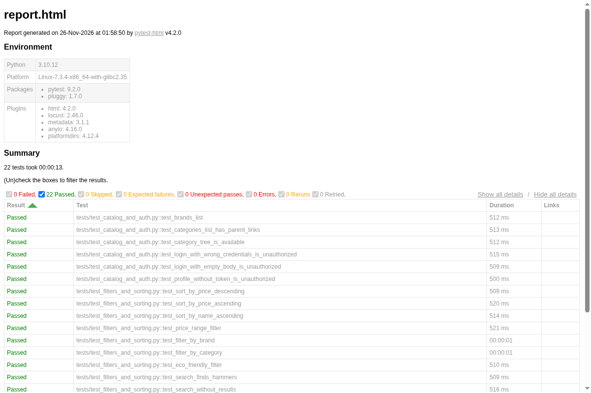

# Toolshop API tests

pytest tests for the REST API behind the [Practice Software Testing](https://practicesoftwaretesting.com) toolshop demo (api.practicesoftwaretesting.com). This API is built for testers, so it is a good place to practise pagination, sorting, filters and search.



## What is covered

| File | Checks |
|---|---|
| `test_products.py` | pagination fields, page count vs total, no repeated products between pages, empty page past the end, JSON schema for every product, details match the list, 404 for unknown id |
| `test_filters_and_sorting.py` | sort by price (asc and desc) and name, price range, filter by brand, category and eco friendly, search with and without results |
| `test_catalog_and_auth.py` | brands, categories (parent links), category tree, wrong login, empty login body, profile without token |

22 tests, all read-only (no data is created on the shared server).

## Run it

```bash
git clone https://github.com/Belaalos/toolshop-api-tests.git
cd toolshop-api-tests
python -m venv .venv && source .venv/bin/activate   # Windows: .venv\Scripts\activate
pip install -r requirements.txt
pytest
```

Report: `reports/report.html`. Also runs on GitHub Actions.

## Observations from exploring the API

These are my notes from manual calls before writing the tests. I did not turn them into failing tests because I am not sure they are bugs.

- `GET /products?page=0` and `?page=abc` return **200** and the first page, there is no 400 for a bad page value.
- `GET /products?page=999` returns 200 with an empty list and `current_page: 999`.
- Search with an empty `q` returns 200 with 0 results.

Belal Magdy | QA | [LinkedIn](https://www.linkedin.com/in/belal-magdy-23sep2001)
